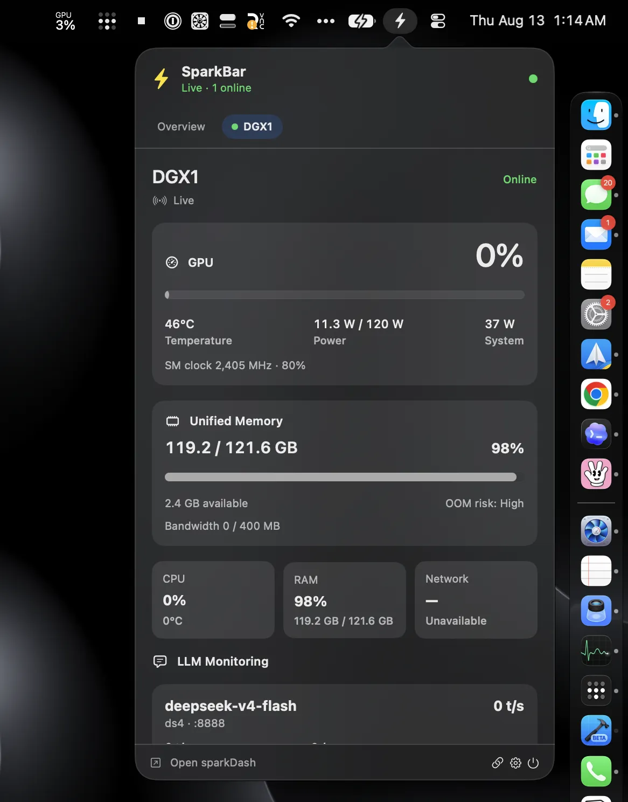

# SparkBar

A native macOS menu-bar companion for sparkDash that keeps DGX Spark and GPU-host metrics one glance away.

<p align="center">
  
</p>

Signed releases will appear on the [Releases page](https://github.com/sambitcreate/sparkbar-mac-dgx/releases) once the Developer ID certificate and notarization credentials are configured. You can [build from source](#quick-start) now.

## What it is

SparkBar lives in your menu bar and streams live DGX Spark snapshots over WebSocket: GPU utilization and temperature, unified memory pressure, power draw, and LLM throughput. No SSH, no shell commands, no agent on the box — it is deliberately read-only and consumes only `GET /api/sparks` for connection validation and a single `WS /ws` stream for live data.

- The menu bar item shows the live metric you choose — GPU utilization, temperature, unified memory, LLM tokens/sec, or GPU + temperature — and switches to a warning icon when a Spark alerts. Right-click it for **Open sparkDash**, **Settings**, and **Quit**. Signed releases also offer **Check for Updates**.
- The popover shows an overview of all Sparks, per-Spark detail pages (GPU, unified memory, network, storage, LLM and ComfyUI monitoring, Hermes Agent updates), and a rolling GPU/memory history chart.
- If sparkDash is reachable over REST but its WebSocket is blocked, SparkBar keeps refreshing through `GET /api/sparks/:id/metrics` polling until the stream recovers.

## Quick start

### Prerequisites

- macOS 14 Sonoma or newer
- Xcode 16.2 or newer, with Swift 6.0 or newer
- A reachable sparkDash-compatible endpoint

### Build from source

```sh
git clone https://github.com/sambitcreate/sparkbar-mac-dgx.git
cd sparkbar-mac-dgx
swift build
./scripts/build-app.sh
open .build/Release/SparkBar.app
```

`build-app.sh` assembles the `.app` bundle; `swift build` alone is enough for development and testing.

### Run the tests

```sh
swift test
```

All networking, decoding, selection, formatting, history, and alert logic lives in `SparkBarCore`, so the suite runs without launching AppKit. The app target adds the `NSStatusItem`, the SwiftUI popover and settings window, launch-at-login, and notifications.

## Connect to sparkDash

SparkBar depends on a running sparkDash (or compatible) instance, which collects DGX Spark / GPU-host metrics and exposes the REST/WebSocket API that SparkBar monitors. On first launch SparkBar has no endpoint configured; click the menu bar icon and enter your sparkDash URL in the connection view. The usual deployment is Docker from your sparkDash checkout:

```sh
cd sparkDash
docker compose up --build -d
```

Then point SparkBar at that server: `http://localhost:5555` when it runs on the same Mac, or `http://<host-ip>:5555` over LAN or Tailscale. From sparkDash 1.8.2 the server binds to `127.0.0.1` by default; a menu-bar client on another Mac needs `BIND_HOST=0.0.0.0` (or Docker Compose, which already binds `0.0.0.0`). For a development checkout, use `npm install` followed by `npm run dev`. See your sparkDash documentation for DGX and GPU-host setup.

SparkBar accepts any `http://`, `https://`, `ws://`, or `wss://` base URL; HTTP maps to WS and HTTPS maps to WSS automatically.

### Scan, Bonjour, and Tailscale

Click the menu bar **Scan** title to open the popover, then tap **Scan**. Enter an optional **Known host** to check one hostname or IP, and change **Probe port** if sparkDash does not use 5555. The scan shows progress and can be stopped. LAN probing covers RFC1918 `/24` networks only — it does not sweep Tailscale CGNAT.

In Settings → Connection you can optionally enable:

- **Bonjour** — browse `_sparkdash._tcp`. sparkDash does not advertise this unless you set `SPARKDASH_BONJOUR=1` on the server (`dns-sd` on macOS, `avahi-publish-service` on Linux).
- **Tailscale LocalAPI** — read the local Tailscale app’s peer list and probe those IPs on port 5555. SparkBar still confirms with `GET /api/sparks`. The Tailscale app must be running on this Mac.

### A note on HTTP

HTTP is enabled in the app bundle because sparkDash is commonly reached over a trusted LAN or Tailscale network. SparkBar is read-only and restricts itself to the monitoring REST endpoints and `/ws`. A public HTTP endpoint requires explicit confirmation before connecting. Use HTTPS/WSS or an authenticated reverse proxy when the endpoint is not on a trusted private network.

## Live smoke test

Check an endpoint without launching the app:

```sh
curl -i http://localhost:5555/api/sparks
curl -i http://localhost:5555/api/settings
swift run SparkBarSmoke http://localhost:5555
```

## CI, releases, and signing

- `CI` runs on pull requests and pushes to `main` on macOS 26 and minimum-supported macOS 14 runners: Swift tests, packaged app build, and bundle validation. Changes to only `.md` files skip verification.
- `Release macOS` runs on version tags (`v*`) and via manual dispatch from the Actions tab. Tag pushes publish the tagged version (`v1.2.3` ships as `1.2.3`); manual runs build `0.1.<run number>` as a verification artifact without changing the latest public release.
- Public releases require Developer ID signing and Apple notarization. The pipeline uploads a stapled DMG, ZIP update archive, EdDSA-signed Sparkle appcast, and SHA-256 checksums. It stops before publishing if any credential or notarization check fails.
- Sparkle checks the [latest release appcast](https://github.com/sambitcreate/sparkbar-mac-dgx/releases/latest/download/appcast.xml) in signed builds. Source builds keep update checks disabled.
- `Pullfrog` is available via manual workflow dispatch; add at least one provider key (e.g. `OPENAI_API_KEY`) as a repository Actions secret first. It is intentionally not attached to `pull_request`, so provider secrets are never exposed to fork code.

### Enable signed and notarized releases

The release workflow never exposes signing credentials to pull requests. To enable the signed path, add these repository secrets:

- `MACOS_CERTIFICATE_P12_BASE64` — base64 of a Developer ID Application `.p12` containing the certificate and private key
- `MACOS_CERTIFICATE_PASSWORD` — password used when exporting that `.p12`
- `APPLE_API_KEY_ID` — App Store Connect API key ID
- `APPLE_API_ISSUER_ID` — App Store Connect issuer ID
- `APPLE_API_PRIVATE_KEY_BASE64` — base64 of the App Store Connect `AuthKey_<key-id>.p8`
- `SPARKLE_EDDSA_PRIVATE_KEY` — the private Sparkle update key exported by `generate_keys`; its matching public key is in `Info.plist`

And this repository variable:

- `MACOS_SIGNING_IDENTITY` — the exact identity, e.g. `Developer ID Application: Your Name (TEAMID)`

Create the Developer ID Application certificate in [Apple Developer Certificates](https://developer.apple.com/help/account/certificates/create-developer-id-certificates), export it with its private key from Keychain Access, and create the App Store Connect API key from [Users and Access](https://appstoreconnect.apple.com/access/integrations/api). Never commit the `.p12`, `.p8`, certificate password, or API credentials. Apple requires Developer ID signing, hardened runtime, and a secure timestamp for notarized software; the workflow applies all three before submitting with `notarytool`.

See [CONTRIBUTING.md](CONTRIBUTING.md) for local verification commands and pull request expectations.

## License

SparkBar is available under the [MIT License](LICENSE).
